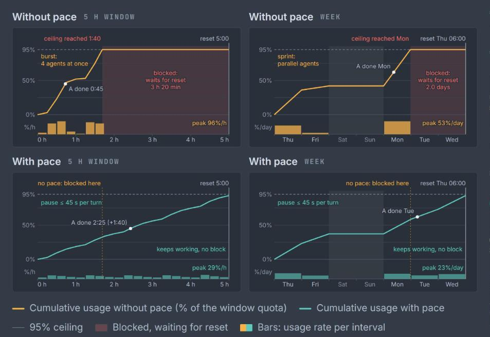

# pace

**Cadence for Claude Code: spread your 5 h and weekly limits instead of hitting the ceiling.**

- **Heavy Pro/Max use:** a gauge with limits for the 5 h and weekly windows.
- **Many fronts at once:** parallel agents share one steady cadence.
- **Same quota, other tools:** heavy Desktop/Design slows Claude Code.
- **Fewer stalls:** the pause grows before the 5 h window hits the ceiling.
- **Weekly reserve:** spreads the week over business days, 5% kept.
- **One account:** all sessions and subagents count together.
- **Predictable cost:** pauses stay under the cache TTL.
- **See first:** `pace measure` shows the cut, pauses nothing.
- **Your control:** off by default, manual step, fail-open.



*Illustrative model, not measured data. Pace delays calls; it does not reduce the tokens a task needs. The same work finishes later than an unrestricted burst, but without hitting the ceiling and stalling until the reset. A marks when the same task set finishes in each chart.*

## Requirements

| You need | Why |
|---|---|
| Claude Code 2.1.80 or later | the status line input carries `rate_limits` from that version; without it pace has no data |
| A Claude Pro or Max plan | `rate_limits` is only sent for those plans; API-key sessions stay `[n/a]` |
| Python 3 on `PATH` (`python3`, `python`, or `py -3`) | every hook and the `/pace` command are one Python file |
| Git for Windows, on Windows | Claude Code runs hook commands through Git Bash when it is installed and through PowerShell otherwise (hooks documentation); the hook commands use `||`, which PowerShell does not run as a fallback (see Limits) |

## Install

```
/plugin marketplace add brunomaida/claude-pace
/plugin install pace@claude-pace
```

Then, once:

```
/pace setup
/pace on
```

`/pace setup` is needed because a plugin cannot install a status line, and the status line is the only place Claude Code hands pace your usage. It is safe to run twice:

- No status line yet: pace writes one that shows its own line (`/pace setup silent` writes one that records and prints nothing).
- You already have a status line: it is kept, and pace prints the one line to add to your script.
- `settings.json` is backed up first and left alone if it is not valid JSON.

Axes start OFF (observe only). `/pace on` turns both on; `/pace wk on` and `/pace 5h on` turn one.

The first `/pace` command after install (other than `setup` and `template`) prints a one-time menu with the three status line choices: a ready layout, keep yours (`/pace template off`), or one summary line after yours (`/pace template after`). `/pace setup` on a status line of your own points at `after` too. `after` needs your script to call `statusline --full --after` and look at the first byte of the reply: `\x02` is one line to print after your own lines, `\x01` is the cadence segment, anything else is a whole layout to print as it is. A script that does not pass `--after` is unaffected.

## Commands

| Command | Does |
|---|---|
| `/pace status` | state, rate against budget, current delay and subagent cap |
| `/pace brief` | one line per axis, short enough for a narrow client |
| `/pace guide` | opens the manual in your browser, or prints its path in a remote session |
| `/pace [wk\|5h] on` / `off` | apply or stop pacing, per axis or both |
| `/pace [wk\|5h] measure [on\|off]` | show the proposed reduction without applying it |
| `/pace up` / `down` / `auto` / `reset` | make the cadence stricter or looser, or return to the suggestion |
| `/pace template L1\|L2\|C1\|C2\|after\|off` | choose the status line layout; `after` adds one summary line after your own status line |
| `/pace setup [silent]` | install the status line entry |

You can also type `pace on`, `pace status` and the rest without the slash; the prompt hook handles them.

## The manual

`/pace guide` opens `docs/pacing-cadencer-readme.html` from the installed plugin: how the budget and the two axes work, every command, the configuration keys and the status line layouts. The manual's install section describes copying the files into `~/.claude` by hand, which is the route for people who do not use the plugin system.

## Configuration

Optional. Put keys in `~/.claude/config/pacing.config.json` (or point `CLAUDE_PACING_CONFIG` at a file); unknown keys are ignored.

| Key | Default | Meaning |
|---|---|---|
| `ceiling_pct` | `95` | share of the weekly quota the budget may reach |
| `cap_s` | `45` | longest single delay, in seconds |
| `n_max` | `2` | concurrent subagents at level 2 and above |
| `workdays` | `[0,1,2,3,4]` | days the weekly budget is spread over (Monday is 0) |
| `hours` | `[0,24]` | active hours inside a day |
| `exempt_agents` | `[]` | subagent types that are never counted or capped |
| `exempt_tools` | `["AskUserQuestion","ExitPlanMode"]` | tools that are never delayed |

The full list is `DEFAULTS` at the top of `scripts/pacing.py`.

## Updating and removing

After a plugin update, pace refreshes the copy of the script that the status line runs on your next prompt, so there is nothing to redo. Version 0.14 moves the state to a private per-user directory on Linux and macOS: run `/pace on` again once.

To remove it:

```
/plugin uninstall pace@claude-pace
```

then delete the `statusLine` entry that `/pace setup` added to `~/.claude/settings.json` (the backup next to it is named `settings.json.pace-backup-<time>`) and the folder `~/.claude/pace/`. State lives in your system temp directory under `claude-pacing` (`claude-pacing-<uid>`, mode 0700, on Linux and macOS) and holds no secrets. Until you remove that `statusLine` entry, the status line keeps running the copy in `~/.claude/pace/`. See [SECURITY.md](SECURITY.md).

## Tested on

Only what has actually been run is listed. The package carries an install simulator (`tests/test_install.py`) that runs the hook commands and the command line through the shells and Python launchers present on the machine, in a profile whose path has a space and an accent. The `test` workflow runs it, with the rest of the package suite (273 tests), on every push.

| Where (GitHub runner) | Shell | Python | Result |
|---|---|---|---|
| Ubuntu, macOS (Apple silicon), Windows | `sh`, `sh`, Git Bash | 3.9, 3.10, 3.11, 3.12, 3.13, 3.14 | all pass: chain, each interpreter, first one or two missing, `python` absent, script missing, `settings.json` variants |
| Debian 12 slim, Fedora, Alpine containers | `sh` | system `python3`, no `python` | all pass: the chain falls through to `python3` |
| Windows | PowerShell 5.1 and PowerShell 7 | 3.9 to 3.14 | pass for each single interpreter and the absolute path; the `a \|\| b` chain is not run (see Limits) |

Run by hand against the real Claude Code host (2.1.300, Windows 11, plugin loaded with `--plugin-dir`, state isolated):

| Check | Result |
|---|---|
| Plugin hooks load and `/pace status` is answered by the prompt hook | pass |
| `/pace:pace status` runs the command body, `${CLAUDE_PLUGIN_ROOT}` expands, `allowed-tools` approves it with no prompt | pass on 0.14 with the anchored rules (`claude -p`, no permission denial; the `python3 \|\| python` chain fell through on a host with no `python3`) |
| A decided pause is slept for a Bash and for a Read call (matcher omitted) | pass, pause marker written, no `pacing.err` |
| A real subagent takes a slot at `SubagentStart` and releases it at `SubagentStop` | pass |
| `/pace guide` hands the manual to the OS opener (`os.startfile`) | ran without error; the browser window was not observed by the test |

Not covered by any run: the host on macOS or Linux, `/pace setup` through the host (it rewrites your real `settings.json`), Linux distributions other than Ubuntu, Debian, Fedora and Alpine.

## Limits

- No status line, no data. Without `/pace setup` (or your own status line feeding pace) there are no samples, and pace stays inert.
- API-key sessions send no usage data; `/pace status` says so.
- Hook commands try `py -3`, then `python3`, then `python`, using `||`, and end in `exit 1`. This is run by `sh` and Git Bash. Windows PowerShell 5.1 has no `||`, so with it alone (no Git for Windows) the hooks fail to start. PowerShell 7 parses `||` but a missing command is an error there rather than a failure to fall through, so under PowerShell the hooks work only when the first interpreter, `py`, exists (the python.org installer provides it). Installing Git for Windows avoids both.
- Python missing from `PATH` makes every hook and `/pace` fail visibly and nothing is throttled.
- `/pace on` delays tool calls by design; pacing never exceeds `cap_s` per model turn and keeps the gap short enough to stay inside the prompt cache.

## License

MIT, see `LICENSE`.
